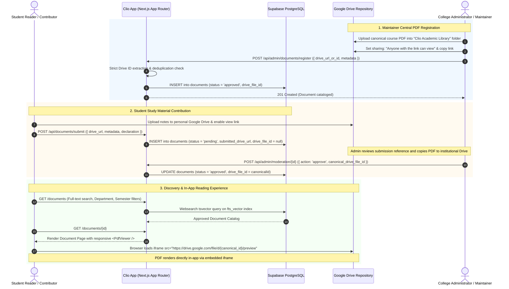

# Clio 📜
> **Knowledge, preserved. — Academic Resource & PDF Knowledge Hub for Colleges**

Clio is a full-stack, mobile-responsive academic document library designed for higher-education institutions. Named after the Greek muse of history and archival preservation, it replaces fragmented messaging group sharing with an organized, searchable, community-moderated knowledge repository.

Students discover, read, preview, bookmark, and download academic PDFs (lecture notes, unit-wise notes, previous-year question papers, lab manuals, assignment solutions, revision cheat sheets) directly inside Clio, while maintainers manage catalog curation by embedding Google Drive resources without requiring separate commercial object storage.

---

## Architecture Overview

Clio is built on a **destination-website architecture**:
- **PostgreSQL (Supabase)**: Stores structured metadata, academic taxonomy, full-text search indexes (`tsvector`), relational constraints, and audit logs.
- **Supabase Authentication & Row-Level Security (RLS)**: Enforces role-based permissions (`student` vs `admin`) and admission policies natively inside PostgreSQL.
- **Google Drive Embedded PDF Library**: Canonical course PDFs are stored in a central Google Drive folder (leveraging institutional Google Workspace accounts) and rendered in-app via responsive Google Drive preview frames (`https://drive.google.com/file/d/FILE_ID/preview`). Clio does not proxy or stream raw PDF bytes through its server; it serves verified Drive links to the browser.
- **Account Quotas & Terms**: Storage allocations (e.g. typical 5 TB institutional Google Workspace allocations) and link-sharing policies depend on the administrator's Google account tier and Google's Terms of Service.
- **No Paid Object Storage Bills**: Replaces standalone AWS S3 or Cloudflare R2 infrastructure, eliminating per-gigabyte cloud storage bills and egress costs.
- **Destination Website Experience**: Students read course documents directly inside Clio with full-screen zoom, reload controls, and embedded navigation without unwanted external redirects.



---

## Key Features & Invariants

### 1. In-App Google Drive Embedded Viewer
- **Native Destination Experience**: PDFs are embedded directly inside the document detail view using an optimized iframe with `allow="autoplay"` and sandbox controls (`allow-scripts allow-same-origin allow-popups allow-popups-to-escape-sandbox allow-forms allow-downloads`).
- **Reading Controls**: Integrated full-screen expansion, iframe reload button, and external tab link.
- **Strict URL Sanitization**: All Google Drive URLs are parsed via `src/lib/drive/urls.ts` against `/^[a-zA-Z0-9_-]{25,55}$/`, rejecting unauthorized domains, `javascript:` injection, and malformed strings.
- **Content Security Policy (CSP)**: `next.config.ts` enforces `frame-src 'self' https://drive.google.com https://docs.google.com;`.

### 2. Flexible Institution Admission Policy
Configurable through environment variables without modifying code:
- `open`: Any valid email address can register (ideal for development and testing).
- `domain_restricted`: Only email addresses belonging to specified domains (e.g. `yourcollege.edu`, `student.yourcollege.edu`) can register.
- `invite_only`: Public self-registration is closed; accounts are provisioned by an administrator.

### 3. Database Security & Privilege Escalation Prevention
- **Supabase Row-Level Security (RLS)** is active across all tables (`profiles`, `documents`, `reports`, `favorites`, `download_logs`, `audit_logs`).
- **Trigger-Enforced Student Role**: The `handle_new_user()` auth trigger automatically provisions profiles with `role = 'student'` and `status = 'active'`, ignoring any role passed in client metadata.
- **Admin Privilege Isolation**: Users cannot escalate their own role. Administrator privileges are granted via database procedures or secure server administration.

### 4. Academic Organization & Search
- Full-text search across titles, descriptions, subjects, and tags using PostgreSQL `tsvector` with English stemming and a `GIN` index.
- Comprehensive academic taxonomy:
  - **Departments**: Computer Science, Electronics & Communication, Mechanical, Civil, Electrical, Information Technology, Applied Sciences, Management.
  - **Academic Years**: 1st Year through Postgraduate / Research.
  - **Semesters**: Semester 1 through Semester 8.
  - **Units**: Unit 1 through Unit 6, and Complete Syllabus.
  - **Material Types**: Lecture Notes, Unit Notes, PYQ, Lab Manuals, Assignments & Solutions, Revision Notes, Reference Material.

---

## Database Migrations

Database schema migrations are located in `supabase/migrations/`:

| Migration File | Description |
| :--- | :--- |
| `20261017000001_initial_schema.sql` | Creates `profiles`, `documents`, `reports`, `favorites`, `download_logs`, `audit_logs` tables with constraints and foreign keys. |
| `20261017000002_indexes_and_fts.sql` | Creates composite indexes and full-text search `tsvector` generated column (`fts_vector`) with `GIN` index. |
| `20261017000003_functions_and_triggers.sql` | Implements `handle_new_user()` auth trigger, `is_admin()` security helper, and `increment_document_download()` atomic counter. |
| `20261017000004_row_level_security.sql` | Establishes zero-trust Row Level Security (RLS) policies for all tables. |
| `20261018000001_add_google_drive_storage.sql` | **Additive Google Drive Migration**: Adds `storage_provider`, `drive_file_id` (unique index), `submitted_drive_url`, and relaxes legacy R2 constraints. |
| `20261018024507_fix_handle_new_user_enum_resolution.sql` | Fixes enum resolution in `handle_new_user()` trigger for automated student profile creation. |

---

## Environment Variables

Copy `.env.example` to `.env.local` and configure your credentials:

```bash
cp .env.example .env.local
```

### Variable Reference

| Variable | Description | Example / Default |
| :--- | :--- | :--- |
| `NEXT_PUBLIC_APP_NAME` | Platform name | `Clio` |
| `NEXT_PUBLIC_APP_TAGLINE` | Primary brand tagline | `Knowledge, preserved.` |
| `NEXT_PUBLIC_COLLEGE_NAME` | College/University name | `Your College or University Name` |
| `NEXT_PUBLIC_COLLEGE_SHORT_NAME` | Short institution abbreviation | `College` |
| `NEXT_PUBLIC_COLLEGE_DOMAIN` | Primary institution domain | `yourcollege.edu` |
| `NEXT_PUBLIC_REGISTRATION_MODE` | Admission policy (`open`, `domain_restricted`, `invite_only`) | `open` |
| `NEXT_PUBLIC_ALLOWED_EMAIL_DOMAINS` | Comma-separated list of allowed email domains | `yourcollege.edu,student.yourcollege.edu` |
| `NEXT_PUBLIC_SUPABASE_URL` | Supabase project URL | `https://xxxx.supabase.co` |
| `NEXT_PUBLIC_SUPABASE_PUBLISHABLE_KEY` | Public Supabase publishable key | `sb_publishable_...` |
| `SUPABASE_SECRET_KEY` | Secret Supabase service key, server only | `sb_secret_...` |
| `GOOGLE_CLIENT_ID` | Google OAuth 2.0 Web Client ID (server only) | `xxxx.apps.googleusercontent.com` |
| `GOOGLE_CLIENT_SECRET` | Google OAuth 2.0 Client Secret (server only) | `GOCSPX-xxxx` |
| `GOOGLE_REFRESH_TOKEN` | Offline Refresh Token obtained via `/api/admin/google-drive/auth` | `1//xxxx` |
| `GOOGLE_DRIVE_FOLDER_ID` | Dedicated Library Folder ID in Google Drive | `1RhVVih...` |
| `GOOGLE_DRIVE_ENABLE_PUBLIC_SHARING` | Grants link-reader permissions specifically to each uploaded file | `true` |
| `NEXT_PUBLIC_MAX_FILE_SIZE_MB` | Maximum document upload size in megabytes | `50` |

---

## Local Development & Testing

### Installation & Run
```bash
# 1. Install dependencies
npm install

# 2. Run TypeScript typecheck
npm run typecheck

# 3. Run ESLint
npm run lint

# 4. Run automated test suites (Vitest)
npm run test

# 5. Start development server
npm run dev
```

Visit [http://localhost:3000](http://localhost:3000) to access Clio.

### Diagnostic Health Check
Navigate to `/api/health` to view the automated environment diagnostic check:
- Validates Supabase public and server-side configurations.
- Reports storage status as `google_drive` (`zero_additional_cost`).

### Production Build
```bash
npm run build
npm run start
```

---

## License

This project is open-source under the MIT License.
