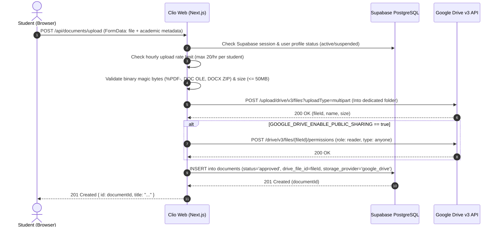

# Clio — Direct Google Drive Upload Pipeline

> **Direct Website Uploads | Admin-Designated Google Drive | Zero Additional Service Costs**

---

## 1. Overview & Architecture

Clio allows verified students to upload academic study materials (PDF, DOC, DOCX) directly through the native `/upload` page. The Next.js server validates the authenticated session, rate limits, file size, academic metadata, and performs deep binary magic-byte inspection before streaming the file directly into a dedicated folder on the administrator's Google Drive.

Upon successful upload to Google Drive:
1. Clio optionally applies per-file public reader permissions (`anyone with the link can view`) solely to that individual uploaded file, without ever exposing or modifying the permissions of the parent folder or any other files on Drive.
2. Clio persists the verified file metadata and Drive file ID into Supabase PostgreSQL with `status: 'approved'` (for the pilot release), making it immediately discoverable and readable inside Clio via the embedded Google Drive reader (`/documents/[id]`).



---

## 2. Security & Privilege Boundaries

| Security Layer | Implementation Details |
|---|---|
| **Narrow OAuth Scope** | Uses `https://www.googleapis.com/auth/drive.file`. Google explicitly restricts this scope to files created or opened by the Clio application. Clio **cannot** list, view, modify, or delete any of the administrator's personal files, photos, or other Drive directories. |
| **Server-Side Token Isolation** | `GOOGLE_CLIENT_SECRET` and `GOOGLE_REFRESH_TOKEN` are strictly kept server-side in environment variables. They are never exported in public bundles, client components, or API responses. |
| **Isolated Target Folder** | All student uploads are deposited strictly within `GOOGLE_DRIVE_FOLDER_ID` ("Clio Academic Library"). |
| **Strict Per-File Permissions** | When `GOOGLE_DRIVE_ENABLE_PUBLIC_SHARING="true"`, permissions are created per-file (`role: reader`, `type: anyone`). The target folder itself is never changed to public by Clio. |
| **Deep Magic-Byte Inspection** | File extensions can be falsified. The server inspects the initial byte sequences in memory: `%PDF-` for PDFs, `0xD0 0xCF 0x11 0xE0` for DOC, and `PK\x03\x04` for DOCX. Executable and disguised scripts are immediately rejected. |
| **Student Rate Limiting & Auth** | Uploads require an active Supabase user session. Suspended users are rejected. Students are capped at 20 uploads per hour. |

---

## 3. Administrator Setup Guide (One-Time Setup)

### Step 1: Google Cloud Project Setup
1. Go to the [Google Cloud Console](https://console.cloud.google.com/).
2. Create a new project (e.g., `Clio Academic Library`).
3. Navigate to **APIs & Services > Library**, search for **Google Drive API**, and click **Enable**.

### Step 2: Configure OAuth Consent Screen
1. Go to **APIs & Services > OAuth consent screen**.
2. Select **External** (or **Internal** if using Google Workspace).
3. Fill in the App Name (`Clio`), User Support Email, and Developer Contact Email.
4. On the **Scopes** page, add the scope:
   - `https://www.googleapis.com/auth/drive.file`
5. On the **Test Users** page (if External), add the administrator's Google email address.

### Step 3: Create OAuth 2.0 Client Credentials
1. Go to **APIs & Services > Credentials** and click **Create Credentials > OAuth client ID**.
2. Application type: **Web application**.
3. Name: `Clio Backend Server`.
4. Authorized redirect URIs:
   - Local development: `http://localhost:3000/api/admin/google-drive/callback`
   - Production: `https://your-domain.com/api/admin/google-drive/callback`
5. Save the generated **Client ID** and **Client Secret**.

### Step 4: Authorize & Automatically Initialize Dedicated Folder
1. Add `GOOGLE_CLIENT_ID` and `GOOGLE_CLIENT_SECRET` to `.env.local`.
2. As an authenticated administrator in Clio, visit:
   `http://localhost:3000/api/admin/google-drive/auth`
3. Sign in with the administrator Google account and grant file access permission under the narrow `drive.file` scope.
4. Google redirects back to `/api/admin/google-drive/callback`.
5. Clio automatically checks if a dedicated `Clio Academic Library` folder already exists for this app. If not found, it creates the folder directly through the Google Drive v3 REST API. Because the app creates the folder itself, it has full access to upload files into it under `drive.file` scope. Repeat authorizations discover and reuse the existing folder, preventing duplicate folder creation.
6. The setup page displays both values to save into `.env.local`:
   - `GOOGLE_DRIVE_FOLDER_ID`
   - `GOOGLE_REFRESH_TOKEN`
7. Copy both values into `.env.local` and restart your Next.js server.
8. Verify connectivity anytime at `/api/admin/google-drive/status` or click **Test Connection** in the Admin Console.

---

## 4. Environment Variables Reference

```ini
# Google Drive OAuth (Server-side ONLY)
GOOGLE_CLIENT_ID="123456789-abcdef.apps.googleusercontent.com"
GOOGLE_CLIENT_SECRET="GOCSPX-yourClientSecret"
GOOGLE_REFRESH_TOKEN="1//0gABCDEF...yourRefreshToken"

# Destination Folder ID in Google Drive
GOOGLE_DRIVE_FOLDER_ID="1A2B3C4D5E6F7G8H9I0J"

# Enable public view permission per uploaded file (true/false)
GOOGLE_DRIVE_ENABLE_PUBLIC_SHARING="true"

# Maximum upload file size in MB
NEXT_PUBLIC_MAX_FILE_SIZE_MB="50"
```

---

## 5. In-App Document Reading Experience

Uploaded documents are instantly viewable by students through Clio's responsive in-app reader:
- **Embedded Viewer**: `https://drive.google.com/file/d/{drive_file_id}/preview` rendered in a secure iframe.
- **Reading Controls**: Students can bookmark, report, view academic classification (subject, department, semester, unit), and view author attribution without leaving Clio.
