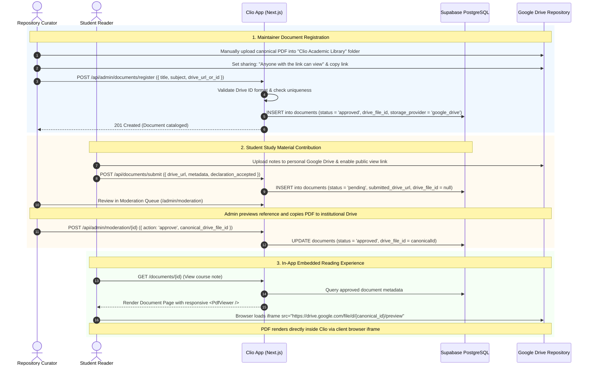

# Clio — Google Drive Embedded PDF Storage Methodology

> **Embedded Academic PDF Library | Zero Cloud Storage Bills | In-App Destination Experience**

---

## 1. Executive Summary

Clio uses an embedded **Google Drive PDF Library methodology** for all academic course materials, lecture notes, syllabus guides, and previous-year question papers.

This methodology replaces commercial object storage (such as Cloudflare R2 or AWS S3) with an in-app viewer:
- **No Third-Party Object Storage Bills**: Utilizes the institution's existing Google Drive repository without per-gigabyte cloud storage fees or egress charges.
- **Quota & Policy Reality**: Institutional storage capacities (such as 5 TB allocations in Google Workspace for Education) and link-sharing policies depend on the institution's actual Google Workspace account tier and Google's Terms of Service. Clio does not make guarantees of permanent zero cost or unlimited storage.
- **Client-Side Iframe Rendering**: Clio does NOT proxy or stream raw PDF bytes through its server; it returns verified Drive file identifiers and canonical URLs while the client browser renders the embedded Google Drive iframe.
- **Zero API Billing or OAuth Keys**: Requires no Google Cloud OAuth clients, no service account JSON keys, and no Google Workspace API billing accounts.
- **Destination Website Experience**: Students discover, preview, and read academic PDFs directly inside the Clio interface via responsive embedded frames (`https://drive.google.com/file/d/FILE_ID/preview`), without unwanted external redirects.
- **Full Supabase Preservation**: Supabase PostgreSQL continues to manage user authentication, document metadata, academic taxonomy, full-text search (`tsvector`), bookmarks, audit logging, and administrative review.

---

## 2. Architecture & Data Flow



---

## 3. Maintainer Operational Runbook

### Step 1: Central Repository Folder Setup
1. Log in to your central **institutional Google Drive account**.
2. Create a top-level folder: **`Clio Academic Library`**.
3. Create organized subfolders matching your academic structure:
   - `Computer Science & Engineering/`
   - `Electronics & Communication/`
   - `Mechanical Engineering/`
   - `Question Papers/`
   - `Laboratory Manuals/`
4. Right-click the root folder **`Clio Academic Library`** → select **Share**.
5. Under **General access**, set to: **`Anyone with the link can view`** (Viewer role).
6. Click **Done**. Any file moved into this folder automatically inherits link-view permissions.

### Step 2: Uploading Canonical PDFs
1. Upload course PDFs (lecture notes, exam papers, syllabus units) directly into the appropriate subfolder.
2. Right-click any uploaded PDF → select **Copy link**.

### Step 3: Registering Documents in Clio
1. Sign in to Clio as an administrator.
2. Navigate to the **Clio Admin Console** → **[Register Canonical PDF](http://localhost:3000/admin/register-document)**.
3. Paste the Google Drive share link (or raw file ID) into the link input.
4. The system validates the link instantly and extracts the canonical file ID.
5. (Optional) Click **Test Drive Embed Preview** to verify the file loads properly in an iframe.
6. Complete the academic classification fields:
   - **Title**, **Department**, **Academic Year**, **Semester**, **Subject**, **Material Type**, **Unit**, **Description**, **Tags**.
7. Keep **Publish Immediately to Catalog** checked and click **Register Document**.
8. The resource is immediately available in the student catalog.

---

## 4. Student Contribution & Moderation Workflow

1. Students visit the **[Contribute Academic Material](http://localhost:3000/upload)** page.
2. An interactive guide explains how to share a PDF from personal Google Drive:
   - Set sharing to **"Anyone with the link can view"**.
   - Copy and paste the link into the form.
3. The client and server validate the URL structure using `extractDriveFileId()`.
4. The student fills in the academic taxonomy and accepts the **Academic Honesty & Sharing Declaration**.
5. The submission enters the **Moderation Queue** with status `pending`. The student's link is stored strictly in `submitted_drive_url` as a submission reference; `drive_file_id` remains `null`.
6. Administrators review the document at `/admin/moderation`:
   - Preview the student's submission in an embedded iframe.
   - Verify handwriting readability, topic relevance, and accuracy.
   - Copy the approved PDF into the central institutional repository folder.
   - Click **Approve & Register**, and provide the **Canonical Google Drive Link or File ID** from the central repository.
   - Clio verifies that the canonical file ID is valid, checks for uniqueness, and publishes the document (`status = 'approved'`).
   - The student's original `submitted_drive_url` remains preserved in the record for submission audit history.
   - If rejected, provide mandatory feedback explaining the reason.

---

## 5. Security Architecture & Technical Safeguards

### 1. Strict URL and Identifier Parsing
All Google Drive URLs are parsed through `src/lib/drive/urls.ts`:
- **File ID Regular Expression**: `/^[a-zA-Z0-9_-]{25,55}$/`
- **Domain Whitelist**: Strictly `drive.google.com` and `docs.google.com`.
- **Protocol Restrictions**: Rejects `javascript:`, `data:`, `vbscript:`, `file:`, or non-HTTP schemes.
- **No Direct String Interpolation**: Embed URLs (`https://drive.google.com/file/d/{id}/preview`) are constructed exclusively from validated file IDs, guaranteeing no malicious URLs or phishing pages enter the iframe source.

### 2. Content Security Policy (CSP)
Configured in `next.config.ts`:
```
Content-Security-Policy: frame-src 'self' https://drive.google.com https://docs.google.com;
```
Ensures that the browser only allows iframes from trusted Google Drive origin endpoints.

### 3. Iframe Sandboxing & Download Behavior
The embedded viewer component (`src/components/pdf-viewer.tsx`) specifies:
```html
<iframe
  src="https://drive.google.com/file/d/{fileId}/preview"
  title="Academic Document Preview - {documentTitle}"
  allow="autoplay"
  sandbox="allow-scripts allow-same-origin allow-popups allow-popups-to-escape-sandbox allow-forms allow-downloads"
  loading="lazy"
/>
```
- `allow-scripts allow-same-origin`: Enables native PDF rendering, page zooming, and thumbnail generation inside the Google Drive preview document.
- `allow-popups allow-popups-to-escape-sandbox`: Enables Google Drive's built-in "Pop-out" button (which opens the document in an external tab) and print dialogs to escape the iframe sandbox without triggering browser security blocks.
- `allow-downloads`: Enables Google Drive's built-in download controls to initiate file downloads cleanly without browser console errors.
- `loading="lazy"`: Defers iframe resource loading until the document preview scrolls into view.

### 4. Transparent Security Reality
> [!NOTE]
> Because Google Drive files are configured with **"Anyone with the link can view"**, anyone who obtains the raw file link can view the file outside of Clio. Supabase RLS protects catalog discovery, indexing, bookmarks, and user metadata, while the underlying PDF file is intentionally accessible to students without requiring them to sign in to Google accounts.

---

## 6. Database Schema & Migration

Migration `supabase/migrations/20261018000001_add_google_drive_storage.sql` makes the following safe, additive changes:

```sql
-- 1. Add storage provider tracking
ALTER TABLE public.documents
ADD COLUMN IF NOT EXISTS storage_provider TEXT NOT NULL DEFAULT 'google_drive'
  CHECK (storage_provider IN ('google_drive', 'r2'));

-- 2. Ensure legacy R2 objects are not misclassified as Google Drive documents
UPDATE public.documents
SET storage_provider = 'r2'
WHERE file_key IS NOT NULL AND storage_provider IS NULL;

-- 3. Add canonical Google Drive file identifier
ALTER TABLE public.documents
ADD COLUMN IF NOT EXISTS drive_file_id TEXT;

-- 4. Add contributor submitted review link
ALTER TABLE public.documents
ADD COLUMN IF NOT EXISTS submitted_drive_url TEXT;

-- 5. Relax legacy R2 constraints to support Drive-backed records
ALTER TABLE public.documents ALTER COLUMN file_key DROP NOT NULL;
ALTER TABLE public.documents ALTER COLUMN file_size DROP NOT NULL;

-- 6. Add unique partial index to prevent duplicate Drive uploads
CREATE UNIQUE INDEX IF NOT EXISTS idx_documents_drive_file_id
ON public.documents (drive_file_id)
WHERE drive_file_id IS NOT NULL;
```

---

## 7. Troubleshooting & FAQ

### Q: Why does the PDF viewer show "Document preview unavailable"?
- Check that the Google Drive file permissions are set to **"Anyone with the link can view"**.
- Ensure third-party cookies or browser extensions (like privacy blockers) are not blocking `drive.google.com` frames.
- Verify the document status in Supabase is `approved` and has a valid `drive_file_id`. Pending submissions can only be previewed by the submitting student or an administrator.

### Q: Does Google Drive charge for download bandwidth?
Google Drive does not impose per-gigabyte egress fees for public link viewing. However, Google accounts are subject to standard Google Workspace terms, abuse detection, and bandwidth rate limits.

### Q: Does Clio proxy or stream PDF files?
No. Clio acts as an academic index and metadata catalog. The browser directly loads the PDF through the Google Drive iframe embed or downloads it via direct Google Drive URL (`https://drive.google.com/uc?export=download&id=FILE_ID`), while Supabase atomically records the download count.

### Q: Can a student download the PDF for offline reading?
Yes. Clicking **Download PDF** opens the direct file download URL, which initiates a download directly from Google Drive while recording an atomic download counter in Supabase.
